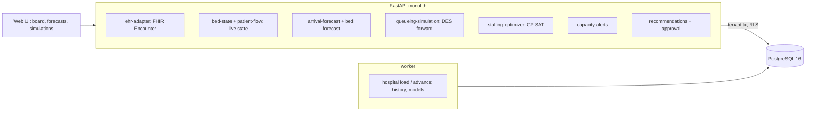

# AI Emergency Department Capacity & Patient Flow

For a hospital's operations centre: it forecasts arrivals and acuity by hour from the department's own history, predicts admissions
and ward bed demand, runs the department forward from its live state many times to show how waiting and boarding will grow, proposes
staffing and bed actions with their simulated effect, and activates nothing until a person approves.

Built from blueprint 10 of "Advanced Engineering Build Book, Volume III" as a **vertical slice**: the demo scenario end to end,
with the platform parts real and the rest listed under [Not built](#not-built-and-why).

**The department, its patients, staff and beds come from a discrete-event simulator in this repository. No real patient data is
used; encounters carry a hashed token and an age band only; nothing here is clinical advice. The forward simulation is the generator
itself run from the live state, which makes its results the floor a real twin could reach, not what one would reach.**

## Run it

```bash
docker compose up --build        # migrates, seeds, serves http://localhost:8220/ui/ with one worker
docker compose run --rm test     # 11 tests against a throwaway database (about 15 s)
```

Open http://localhost:8220/ui/ and press **Run all steps** (about 15 seconds), or `make bootstrap demo`.
Demo tokens (local only): `hosp-ops_director-demo`, `hosp-charge_nurse-demo`, `hosp-viewer-demo`. Run `make reset` before a second demo run.

## The demo, step by step

1. 07:00 on a Tuesday at an invented 32-bed ED with two CT scanners and 122 ward beds: 7,970 encounters from the last eight weeks loaded, 8 patients in beds, nobody waiting. Models fitted on sixteen weeks and tested on the last two: the arrival profile's error is 2.03 an hour against 2.84 for the same hour last week, 84% inside its 80% band; admission AUC 0.78 against 0.73 for triage level alone; the length-of-stay model is no better than the median by triage level, and the page says so.
2. The next 24 hours: 150 arrivals expected with a band and the triage 1–2 share; ward discharges and admissions by hour and the free beds they leave; and the baseline simulation, 30 runs of 12 hours: a peak waiting room of 5 or 6 and a median door-to-bed wait of zero.
3. Four hours pass. The generator is told that 30 injured patients arrive over an hour from 10:00 and that the wards process discharges at 40% of normal for eight hours. The service sees 62 new encounters and their events. At 11:00 every ED bed is full and 23 are waiting.
4. A FHIR Bundle from the ambulance service announces three more: two accepted into the live state, one refused for a missing timezone. The capacity view carries a red alert.
5. The simulation again, told the wards are slow for six more hours, against a package of actions: six surge beds, two nurses on two shifts, a discharge push. Peak waiting 49.5 → 35.5, median door-to-bed 137 → 81 minutes, and the waiting room is still far from clear after twelve hours. Boarding stays low: the ED itself is the bottleneck.
6. The staffing optimiser: P80 census per shift from the runs, nurses required at one to four, the cheapest call-ins by CP-SAT, capped at four a shift; it reports that the evening and night stay short even so. A proposal with a rationale and an expected effect; nothing changes.
7. The charge nurse who proposed it cannot approve it; the operations director does. The call-ins become shifts, the surge beds show on the board, and the audit log has every step.

## Architecture



| Piece | How it works |
|---|---|
| Simulator (`ed/world.py`) | Minute-level discrete events: arrivals by hour-of-day and weekday with a triage mix; a wait for an ED bed by triage then arrival; treatment time by triage, imaging (two CT scanners) and how stretched the nurses are against a 1:4 ratio; admit or discharge; the admitted board until a ward bed frees; wards fill with ED admits and electives and discharge mostly between 10:00 and 20:00. Surges, discharge slowdowns, surge beds, extra nurses and discharge pushes are parameters. |
| Live state | The history to the demo clock, then the generator moved forward with what it was told; the service reads encounters and events, not the telling. Announced FHIR arrivals join the state. |
| Arrival forecast | Mean arrivals by (weekday, hour) over the training weeks with a Poisson 80% band and the triage 1–2 share; baseline: same hour last week. |
| Admission and stay | Gradient-boosted classifier (triage, age, complaint, hour, weekday) with a calibration table; a length-of-stay regressor reported honestly as no better than the median by triage. |
| Bed forecast | Ward turnover from eight weeks of admissions per occupied bed-hour, processed as a daytime backlog; admissions expected from patients in beds (the classifier) and from forecast arrivals; electives on weekday mornings. |
| Forward simulation | The simulator from the live state, 30 runs, with announced constraints and approved actions; P10/P50/P90 per hour for waiting, beds, boarding, wards and the CT queue; KPIs for patients arriving from now. |
| Staffing | P80 census per shift (patients in beds plus half the waiting room) → nurses required at the ratio → CP-SAT picks the cheapest call-ins from the on-call pool, one shift each, capped per shift, with the shortfall reported; surge beds and a discharge push added where the runs say they help; the effect simulated before it is proposed. |
| Approval | A recommendation is proposed, then approved or rejected by an operations director (never its proposer); only approved actions count in the board and in later simulations. |
| Platform | Row-level security per hospital, Postgres job queue, Idempotency-Key replay, hash-chained audit log, `/metrics`. |

## Data model

`migrations/002_ed.sql` follows the blueprint (encounters, encounter_events, beds, bed_occupancy, staff_shifts, forecasts,
recommendations); additions are marked `(+)`: hospitals (seed, clock, what the generator was told), de-identified features on
encounters, shift status and cost, recommendation status and actions.

## API

| Method | Endpoint | Purpose |
|---|---|---|
| POST | `/v1/events/fhir` | A FHIR Bundle of emergency Encounters: announced arrivals join the live state |
| GET | `/v1/capacity/current` | The board: waiting by triage, beds, boarding, CT, wards, nurses, alerts, active actions |
| GET | `/v1/forecast/arrivals?hours=24` | Arrivals per hour with a band and the triage 1–2 share |
| GET | `/v1/forecast/beds` | Ward discharges, admissions, projected free beds and boarding |
| POST | `/v1/simulations/flow` | The department run forward; with actions, side by side |
| POST | `/v1/optimizations/staffing` | Call-ins by CP-SAT plus bed actions, as a proposal with its simulated effect |
| POST | `/v1/recommendations/{id}/approve` | A director approves or rejects; only then do actions count |
| GET | `/v1/recommendations` | (+) Proposals and decisions |
| POST | `/v1/hospital:load` · `/v1/hospital:advance` | (+) 202 + job: load the department; move the clock (the demo's injection) |

Contract: [`docs/openapi.json`](docs/openapi.json).

## Measured

[`docs/evaluation.md`](docs/evaluation.md) (`python -m ed.evaluate`, three departments the demo never uses) and
[`docs/performance.md`](docs/performance.md).

| Component | Result | Baseline |
|---|---|---|
| Arrivals per hour, error | 1.8–1.9 | same hour last week 2.6; 85–88% inside the 80% band |
| Admission AUC | 0.78–0.79 | triage level alone 0.72–0.75 |
| ED length of stay, error | 66–92 min | median by triage 65–93 min: no better |
| Peak waiting 12 h ahead, error | 6–29 | yesterday's peak 6–26: no better; truth under P90 72% |
| Surge: peak waiting with the package | 27–33 | without 42–45; beds alone 30–34; nurses alone no change |

Three things these numbers say plainly. The arrival profile and the admission model earn their place; the length-of-stay model does
not. The forward simulation does not beat "yesterday" on a point estimate, because a morning says little about an afternoon; what it
adds is a band and a reaction to the live state. And in the surge, beds are what help; nurses alone do nothing until the ED is far
over its beds, and boarding stayed low because the ED, not the wards, was the bottleneck in this department's numbers.

## The hardest tradeoff

What "recommend" is allowed to mean. The blueprint asks for operational actions with clinicians in control, and the easy version is a
button that opens the surge beds when a threshold trips. Here the optimiser produces a proposal with a rationale (the census it saw, the
ratio, the solver's choice and its shortfall) and an expected effect from the same simulation anyone can rerun, and the proposal does
nothing until a director who is not its author approves it. The cost is a step and a wait in a department that has neither to spare.
The alternative, actions that activate on their own, would be faster and would make the simulation's errors (a 72% band, no skill
over yesterday on the point estimate) into decisions nobody took.

## Threat model (summary)

| Threat | Mitigation here | Gap |
|---|---|---|
| Patient data in an operations tool | Hashed tokens and age bands only; no names, dates of birth, notes or diagnoses exist in the data | A real adapter would see them and must drop them before storage |
| A forged FHIR message | Only emergency Encounters with a timezone, a valid triage level and a plausible arrival window; duplicates refused; every bundle audited | No sender authentication beyond the API token |
| An action activated without a decision | Proposals carry no effect until approved; the proposer cannot approve; the role that approves is separate | One approver, no second signature |
| One hospital seeing another's board | Row-level security on every table; tested through the API and directly in the database | |

## Not built, and why

- **HL7v2 and a real EHR**: the FHIR reader handles one resource type and five fields; the data is generated.
- **Survival models for discharge readiness**: eight weeks of turnover and a daytime backlog did the job for one ward group; a survival model earns its place with heterogeneous units.
- **Deep temporal models for arrivals**: a weekday-hour profile with a Poisson band beat the baseline; nothing in this world rewards more.
- **A twin that differs from the generator**: the honest limit of a slice; on a real department the simulation would be an approximation and the bands wider.
- **Clinical content of any kind**: the simulator has times, triage levels and dispositions, no diagnoses or treatments.
- **Kafka, Redis, OpenTelemetry, Grafana, MLflow, Terraform, CI, SSO, a Next.js front end**: not needed to prove the slice; no cloud account used.

## Commercial sketch

Buyer: hospitals and health systems' operations centres. Pricing shape from the blueprint: a per-site annual licence with an integration
fee and a command-centre tier. The blueprint says operational decision support, not autonomous clinical care; the approval step is where
that line is drawn here.

## Layout

```
core/        platform kit: db + RLS, jobs, audit chain, HTTP, scenario runner, load test
ed/          world (the department as discrete events), engine (models, forward simulation, staffing), api, seed, evaluate
migrations/  forward-only SQL          web/   UI, scenario.json, demo.json (recorded run)
tests/       11 tests                  docs/  evaluation.md, performance.md, openapi.json
```
